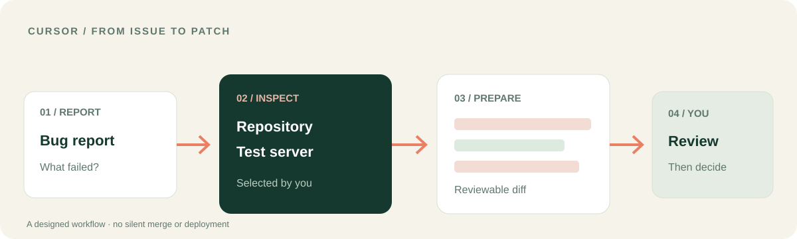

<p></p>

# LUCH for Cursor
### Take the task beyond the editor — and bring the evidence back.

I brought LUCH to Cursor so coding work can reach the environment around it. **LUCH connects that work to the resources you select**: permitted files, a browser session and the exact test server you choose. The aim is a diagnosis and a reviewable change, not a blind release.

[**See the Cursor workflow**](docs/CURSOR_WORKFLOW.md) · [**Install in Cursor**](#connect-in-cursor) · [Русский](README.ru.md) · [LUCH platform](https://github.com/lenar2/luch)



## A Cursor workflow: from bug report to reviewable patch

A bug report says that a page fails after a recent change. Instead of guessing from the code alone:

1. Ask Cursor to inspect the exact repository and issue you selected.
2. If you have paired a test server, ask LUCH for its current status and bounded diagnostic output.
3. Compare the observed environment with the code and identify the likely cause.
4. Prepare a minimal patch and run only the checks you approve.
5. Review the diff and test result. Decide separately whether to merge or deploy.

**What comes back:** the evidence behind the diagnosis, a proposed code change and the checks that were actually run. The release decision stays with you.

[**Open the debugging workflow →**](docs/CURSOR_WORKFLOW.md)

## What LUCH adds to Cursor

| Cursor's working context | LUCH extends it with |
| --- | --- |
| Repository and code | Read or edit the files you selected, with a clear change boundary |
| Browser and running page | Inspect a permitted public page in an isolated server-browser session |
| Test environment | Check the exact paired server and run bounded diagnostic commands when exposed |
| Multi-step fix | Preserve the original, prepare a reviewable change and verify the result |

The plugin includes 12 skills for browser, files, computer, server, control, safety and multi-step workflows. The current Cursor session determines which tools and permissions are actually available.

## Connect in Cursor

1. Install the local plugin in a supported Cursor version:

```bash
mkdir -p ~/.cursor/plugins/local
git clone https://github.com/lenar2/luch-cursor.git ~/.cursor/plugins/local/luch
# If already installed, update that checkout instead of cloning again.
```

2. Reload Cursor. Open **Customize → Plugins** and confirm that LUCH and its skills are detected.
3. Complete the supported OAuth flow with your own enabled LUCH account.
4. Start with an inspection-only request: *“Check the status of the test server I selected. Do not run changes.”*

[Plugin manifest](.cursor-plugin/plugin.json) · [MCP configuration](mcp.json) · [Technical setup](https://luch.lenarsalimov.ru/docs/get-started/)

## Your code. Your environment. Your release decision.

LUCH can help Cursor move from a code suggestion to work grounded in the selected environment. You choose the repository, server and permission scope. A proposed patch is not a deployment.

The public plugin source is available to inspect. Service access and device pairing depend on your account and host. See [service status](https://luch.lenarsalimov.ru/en/status/) or [support](https://luch.lenarsalimov.ru/support/).

<details><summary>For developers and reviewers</summary>

- Cursor plugin version: v0.1.6; 12 skills.
- Manifest: [`.cursor-plugin/plugin.json`](.cursor-plugin/plugin.json); remote MCP: [`mcp.json`](mcp.json).
- A full acceptance run for a new tenant requires OAuth, an authorized test device, a read-only test, a forbidden-path denial and revocation. This README does not claim those tests passed for an independent new user.
- [Security](SECURITY.md) · [Apache-2.0](LICENSE).

</details>
