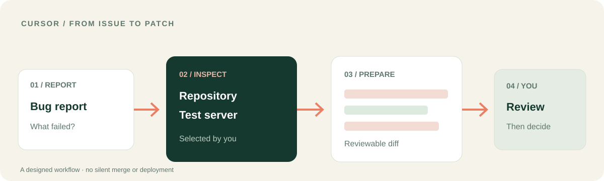

<p></p>

# LUCH для Cursor
### Выведите задачу за пределы редактора — и верните доказательства.

Cursor помогает понимать и менять код. **LUCH соединяет работу с кодом с выбранной средой вокруг него**: разрешёнными файлами, браузером и конкретным тестовым сервером. Цель — диагноз и изменение для ревью, а не незаметный релиз.

[**Сценарий Cursor**](docs/CURSOR_WORKFLOW.ru.md) · [**Установка в Cursor**](#подключение-к-cursor) · [English](README.md) · [Платформа LUCH](https://github.com/lenar2/luch)



## Сценарий Cursor: от сообщения об ошибке к проверяемой правке

В задаче сказано, что страница перестала работать после недавнего изменения. Вместо догадок только по исходникам:

1. Попросите Cursor изучить конкретный репозиторий и выбранную задачу.
2. Если тестовый сервер подключён, запросите через LUCH его текущий статус и ограниченный диагностический вывод.
3. Сопоставьте состояние среды с кодом и найдите вероятную причину.
4. Подготовьте минимальную правку и запустите только те проверки, которые вы разрешили.
5. Изучите diff и результат проверок. Решение о слиянии или публикации остаётся за вами.

**Что вы получаете:** основания диагноза, предлагаемое изменение кода и фактические результаты проверок. Решение о релизе остаётся за человеком.

[**Подробный сценарий отладки →**](docs/CURSOR_WORKFLOW.ru.md)

## Что LUCH добавляет к Cursor

| Контекст Cursor | Что добавляет LUCH |
| --- | --- |
| Репозиторий и код | Чтение или редактирование выбранных файлов с понятной границей изменений |
| Браузер и работающая страница | Проверку разрешённой публичной страницы в изолированном серверном браузере |
| Тестовая среда | Статус точно выбранного сервера и ограниченную диагностику, если инструмент доступен |
| Исправление в несколько этапов | Сохранение оригинала, подготовку правки для ревью и проверку результата |

В плагине 12 навыков для браузера, файлов, компьютера, сервера, управления доступом, безопасности и сложных сценариев. Точный набор инструментов определяется текущей сессией Cursor.

## Подключение к Cursor

1. Установите локальный плагин в поддерживаемой версии Cursor:

```bash
mkdir -p ~/.cursor/plugins/local
git clone https://github.com/lenar2/luch-cursor.git ~/.cursor/plugins/local/luch
# Если папка уже существует, обновите её, а не клонируйте повторно.
```

2. Перезапустите Cursor. Откройте **Customize → Plugins** и проверьте, что LUCH и навыки обнаружены.
3. Пройдите штатную OAuth-авторизацию своим разрешённым аккаунтом LUCH.
4. Начните с проверки без изменений: *«Проверь статус выбранного тестового сервера. Ничего не меняй».*

[Манифест плагина](.cursor-plugin/plugin.json) · [MCP-конфигурация](mcp.json) · [Техническая инструкция](https://luch.lenarsalimov.ru/docs/get-started/)

## Ваш код. Ваша среда. Ваше решение о выпуске.

LUCH помогает Cursor перейти от предложения к работе, основанной на состоянии выбранной среды. Вы выбираете репозиторий, сервер и границы доступа. Предложенная правка ещё не означает публикацию.

Исходники плагина доступны для изучения. Доступ к сервису и подключение устройства зависят от аккаунта и платформы. [Статус сервиса](https://luch.lenarsalimov.ru/ru/status/) · [Поддержка](https://luch.lenarsalimov.ru/support/)

<details><summary>Разработчикам и проверяющим</summary>

- Версия плагина Cursor: v0.1.6; 12 навыков.
- Манифест: [`.cursor-plugin/plugin.json`](.cursor-plugin/plugin.json); удалённый MCP: [`mcp.json`](mcp.json).
- Полная проверка нового аккаунта требует OAuth, разрешённого тестового устройства, чтения, отказа на запрещённом пути и отзыва доступа. Этот README не утверждает, что такие проверки уже пройдены независимым новым пользователем.
- [Безопасность](SECURITY.md) · [Apache-2.0](LICENSE).

</details>
